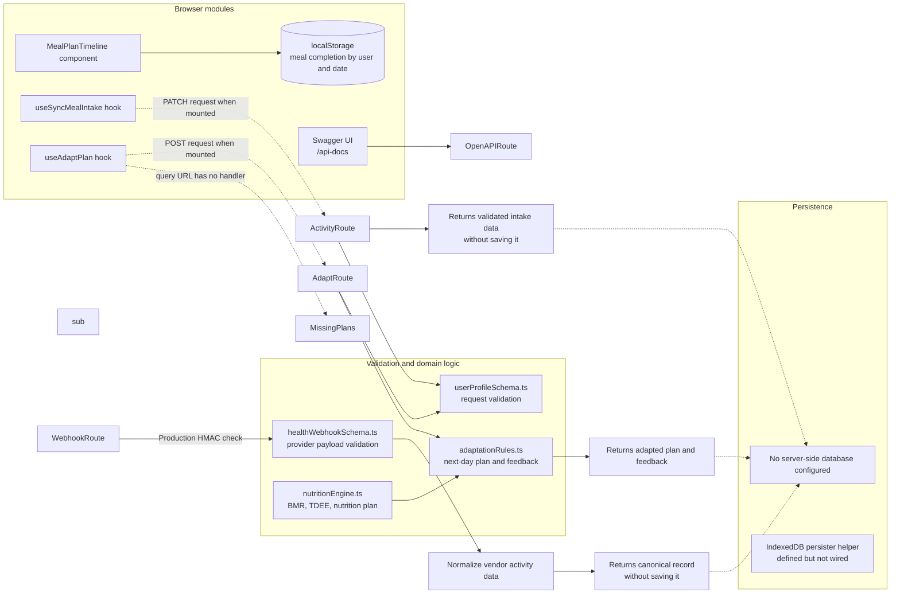

# Application Architecture

## Current State

- The API validates and computes responses, but no route writes customer profiles, plans, intake, or wearable activity to a server-side database.
- Meal completion checkboxes are stored in browser `localStorage`, keyed by user ID and date. This is device- and browser-local.
- An IndexedDB persister helper exists in `lib/queryClient.ts`, but it has no call sites. The TanStack Query hooks and `MealPlanTimeline` also have no page or provider currently mounting them.
- `useAdaptPlan` requests `GET /api/plans`, but no such route exists. Its `POST /api/adapt-plan` path is implemented.
- The nutrition and adaptation engines are pure calculation modules. The health-sync webhook validates and normalizes vendor payloads; it does not persist them.